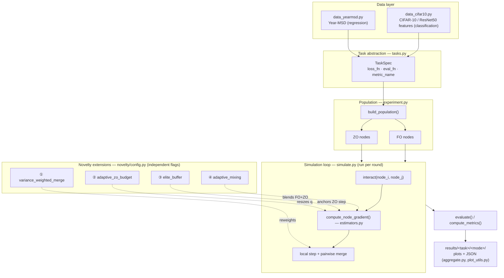
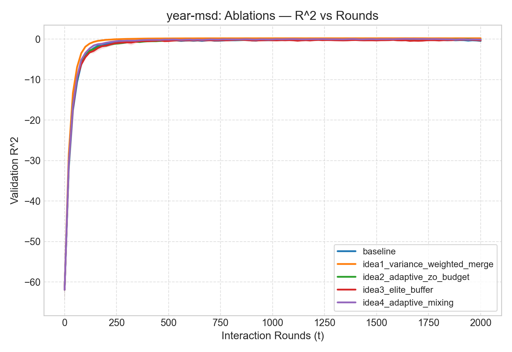
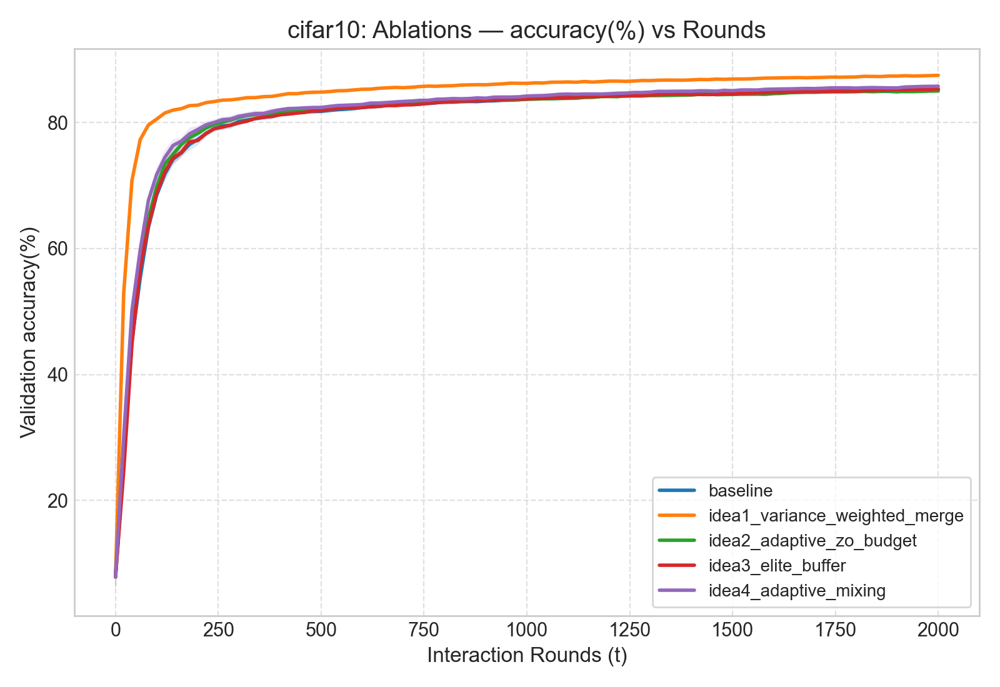

# hdo-extensions

Course project for Optimization Techniques (NITK Surathkal), extending
**"Hybrid Decentralized Optimization: First- and Zeroth-Order Optimizers
Can Be Jointly Leveraged for Faster Convergence"** (Talaei, Nadiradze,
Alistarh — AAAI 2025, [arXiv:2210.07703](https://arxiv.org/abs/2210.07703),
[author repo](https://github.com/ShayanTalaei/HDO)).

Team: D Maithreya (241AI013), Maharshi Kundu (241AI022), Siddhanth R Naik
(241AI040), Sai (241AI0xx) — Guide: Dr. Bhawana Rudra.

The paper's HDO Algorithm 1 runs a population of nodes in a gossip
(population-protocol) network. Each node holds a local copy of the model
and improves it with either a **first-order (FO)** gradient (exact
backprop) or a **zeroth-order (ZO)** gradient (estimated from random
finite differences, no backprop needed). Pairs of nodes interact at
random, each takes a local gradient step, then they average their
parameters together. The paper's result is that a *hybrid* population —
mostly cheap ZO nodes plus a few FO nodes — converges almost as fast as
an all-FO population, at a fraction of the gradient-computation cost.

This repo reproduces that baseline and tests four original extensions to
it (below), on two real datasets the paper itself uses.

## Architecture



All four novelty flags default to **off** in `NoveltyConfig`, in which
case the simulation reduces exactly to the paper's baseline Algorithm 1 —
every ablation is a controlled, single-flag diff against that baseline.

## What's in here

- `src/` — the simulation above: `tasks.py` (task abstraction), `node.py`
  (per-node state, incl. novelty state), `estimators.py` (FO/ZO gradient
  computation), `simulate.py` (the round/interaction loop),
  `experiment.py` (population construction + ablation-suite runner),
  `novelty/config.py` (the four flags), `data_yearmsd.py` /
  `data_cifar10.py` / `data_common.py` (loaders), `aggregate.py` /
  `plot_utils.py` (multi-seed summarizing + plotting).
- `phase0_author_repo/` — instructions for running the paper's own repo
  (`github.com/ShayanTalaei/HDO`) directly, as an independent baseline.
  That repo is cloned elsewhere, not into this one.
- `scripts/extract_cifar10_features.py` — one-time ResNet50 feature
  extraction for the CIFAR-10 task.
- `tests/` — 6 unit tests (`test_estimators.py`) plus 2 synthetic
  end-to-end smoke tests (no real data needed) that exercise every
  novelty path at both task scales (d=90 and d=2048).
- `results/<task>/<mode>/` — committed outputs of every run below:
  plots, aggregated summary JSON, and the raw per-seed/per-round history.

## The four novelty ideas (`src/novelty/config.py`)

1. **`variance_weighted_merge`** — replace the flat pairwise average
   `(X_i+X_j)/2` with an inverse-variance-weighted merge, using a running
   per-node noise proxy (`Node.var_ema`).
2. **`adaptive_zo_budget`** — vary the number of random directions `q` a
   ZO node averages over, per-node, based on that same noise signal
   relative to the ZO population's own average.
3. **`elite_buffer`** — each node keeps a top-K heap of its best historical
   states; with probability `p` a ZO step anchors its perturbation there
   instead of the current iterate; buffers are gossip-merged on interaction.
4. **`adaptive_mixing`** — a subset of ZO nodes also compute an FO-style
   gradient and blend the two via a cosine-similarity-gated, EMA-smoothed
   weight `alpha_t`.

## Results

Hybrid population (n0=16 ZO / n1=4 FO), 2000 rounds, 3 seeds, mean ± std
at the final round. Full per-seed/per-round data and all four plots per
task (loss, metric, consensus potential, adaptive-q) are committed under
`results/<task>/ablation/`.

### Year-MSD (regression — val R²)

| config | val_loss | val_R² | avg_q |
|---|---|---|---|
| baseline | 0.0222 (±0.0040) | −0.4323 (±0.2580) | 1.00 |
| **idea1_variance_weighted_merge** | **0.0120** (±0.0001) | **0.2228** (±0.0037) | 1.00 |
| idea2_adaptive_zo_budget | 0.0171 (±0.0009) | −0.1022 (±0.0597) | 1.42 |
| idea3_elite_buffer | 0.0203 (±0.0011) | −0.3082 (±0.0720) | 1.00 |
| idea4_adaptive_mixing | 0.0169 (±0.0014) | −0.0942 (±0.0926) | 1.00 |



### CIFAR-10 (classification — val accuracy, via frozen ResNet50 features)

| config | val_loss | val_accuracy(%) | avg_q |
|---|---|---|---|
| baseline | 0.5117 (±0.0023) | 85.24 (±0.20) | 1.00 |
| **idea1_variance_weighted_merge** | **0.3976** (±0.0011) | **87.52** (±0.14) | 1.00 |
| idea2_adaptive_zo_budget | 0.5093 (±0.0029) | 85.03 (±0.09) | 1.04 |
| idea3_elite_buffer | 0.5092 (±0.0058) | 85.34 (±0.14) | 1.00 |
| idea4_adaptive_mixing | 0.4831 (±0.0020) | 85.78 (±0.18) | 1.00 |



**Reading these together:** idea 1 (variance-weighted merge) is the
clear, reproducible winner on *both* tasks — one regression, one
classification, d=90 and d=2048 — with tight cross-seed variance, the
strongest kind of evidence a course-project ablation can offer (not a
single-task fluke). Idea 3 (elite buffer) is statistically
indistinguishable from baseline on both tasks. Idea 4 (adaptive mixing)
is a smaller but consistent improvement in between.

Idea 2 (adaptive ZO budget) originally *looked* like the second-best
idea, matching idea 1's gains with `avg_q` pinned at `max_q=10` on every
seed of both tasks. That was a bug: `update_adaptive_budgets()`'s decay
branch did `round(current_q * 0.98)`, and for every integer q in
`[1, 10]` a 2% shrink rounds right back to q itself — the decay was
mathematically inert, so q could only ratchet upward and got stuck at
the cap after the first time any node crossed the increase threshold.
Fixed by switching to a flat per-round decrement (`current_q - 1`); see
`src/simulate.py`. With a genuinely adaptive controller, `avg_q` settles
near its floor instead (1.42 on Year-MSD, 1.04 on CIFAR-10) and idea 2's
performance collapses to roughly baseline on both tasks — the increase
threshold (`budget_increase_threshold=1.5× the ZO population's mean
variance`) is apparently too conservative to ever meaningfully raise the
budget under real conditions. That's a legitimate negative result worth
stating as a limitation rather than a win: the mechanism as configured
doesn't help, and a follow-up sweep over the threshold/decay constants
would be the natural next step rather than retuning `max_q`.

## Datasets — sources and exact save locations

Download these yourself; the loaders expect them at exactly these paths
relative to the repo root (both `data/` paths are gitignored — raw data
never gets committed).

### Year-MSD (regression task)

- **Source:** UCI Machine Learning Repository — "YearPredictionMSD"
  https://archive.ics.uci.edu/dataset/203/yearpredictionmsd
  Direct zip: https://archive.ics.uci.edu/static/public/203/yearpredictionmsd.zip
  (~201 MB zipped, ~428 MB extracted)
- **Save to:** unzip it so you end up with exactly this file:
  ```
  hdo-extensions/data/yearmsd/YearPredictionMSD.txt
  ```
- Each line: `year, feature_1, ..., feature_90` (comma-separated). The
  loader (`src/data_yearmsd.py`) standardizes features and min-max
  normalizes the year label itself, using only the train split's
  statistics.

### CIFAR-10 (classification task, via frozen ResNet50 features)

- **Source:** standard CIFAR-10. `torchvision.datasets.CIFAR10` downloads
  it automatically, via the extraction script below — if that download is
  slow from your network, you can instead fetch
  `https://www.cs.toronto.edu/~kriz/cifar-10-python.tar.gz` yourself and
  place it at `hdo-extensions/data/cifar10_raw/cifar-10-python.tar.gz`
  (the script skips downloading once it finds a file there with the
  matching checksum).
- **Steps:**
  ```
  pip install -r requirements.txt
  python scripts/extract_cifar10_features.py
  ```
  This downloads CIFAR-10, runs every image through an ImageNet-pretrained
  ResNet50 (classification head removed), and saves the resulting 2048-dim
  features to:
  ```
  hdo-extensions/data/cifar10_features/train_features.pt
  hdo-extensions/data/cifar10_features/train_labels.pt
  hdo-extensions/data/cifar10_features/val_features.pt
  hdo-extensions/data/cifar10_features/val_labels.pt
  ```
  Run this once; the actual HDO simulation afterward only ever touches
  these small `.pt` files, never the raw images or the ResNet50 again —
  that's what keeps zeroth-order's extra forward passes affordable. It
  uses CUDA automatically if available (`torch.cuda.is_available()`) —
  worth installing a CUDA build of `torch`/`torchvision` for this step if
  you have an NVIDIA GPU, since it's a one-off ResNet50 forward pass over
  60k images and is far faster on GPU; the HDO simulation itself
  afterward is CPU-bound regardless (its model is a single tiny linear
  layer, GPU doesn't help there).
- **Disclosed deviation from the paper:** the paper trains its own
  ResNet50 first (SGD, 150 epochs) and then freezes it; we use an
  off-the-shelf ImageNet-pretrained ResNet50 instead. Reasonable for a
  course project, but say so explicitly in the report — don't present it
  as using the paper's exact feature extractor.

## Known hyperparameter gotcha (found while testing on the real Year-MSD data)

The original MNIST-tuned default was `eta=0.05`. On Year-MSD specifically
— an **unbounded MSE regression loss**, unlike MNIST's or CIFAR-10's
bounded cross-entropy — that value diverges: the ZO estimator's variance
combined with that large a step size pushed the loss to ~1e17 within ~100
rounds for the `all-ZO` and `hybrid` configs (verified on the real
downloaded file, not just synthetic data). `main.py`'s default is now
`eta=0.01`, which is empirically stable and converges cleanly for all
three population types on both tasks. There's also a `--max_grad_norm`
safety net (default 50.0) that clips any single node's gradient estimate
before it's applied, as defense-in-depth against the same failure mode if
you sweep `eta` higher in your own experiments — it rarely binds at sane
learning rates, it's just there so a bad hyperparameter choice degrades
gracefully instead of silently overflowing to `inf`. If you deliberately
want the old unsafe default back, pass `--eta 0.05` explicitly.

## Running it

```bash
pip install -r requirements.txt

# Plain baseline (all-FO / all-ZO / hybrid), no novelty code active:
python main.py --task yearmsd --mode baseline

# Full four-idea ablation suite on the hybrid population, multi-seed:
python main.py --task yearmsd --mode ablation --seeds 0 1 2

# Same on CIFAR-10 (run the feature extraction script first):
python main.py --task cifar10 --mode ablation --seeds 0 1 2
```

Results (plots + JSON histories) land in `results/<task>/<mode>/`.

Before trusting a CIFAR-10 run, run the synthetic smoke tests
(`python tests/smoke_test.py` and `python tests/smoke_test_highdim.py`) —
they catch bugs in the shared novelty code in seconds instead of minutes.

## Project status

- **Phase 0** (author's-repo baseline, `github.com/ShayanTalaei/HDO` run
  directly) — not started yet; independent of Phases 1/2, can run in
  parallel. Instructions in `phase0_author_repo/SETUP_INSTRUCTIONS.md`.
- **Phase 1** (Year-MSD) — baseline + full 4-idea ablation suite done on
  real data, 3 seeds. See Results above.
- **Phase 2** (CIFAR-10) — full 4-idea ablation suite done on real data
  (ResNet50 features), 3 seeds. See Results above.
- No combination of ideas is planned — the project stops at the 4
  individual ablations per the agreed plan.

See `PROGRESS.md` for the commit-by-commit log of how this was built.
